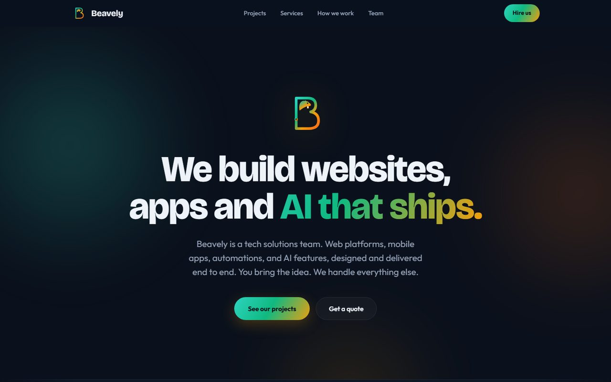
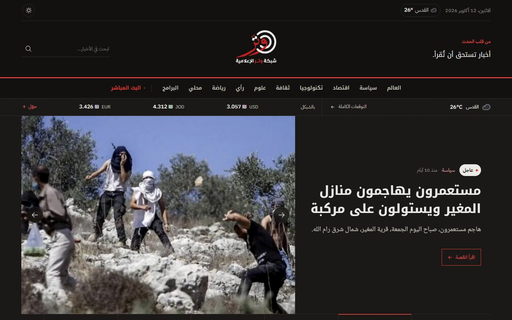
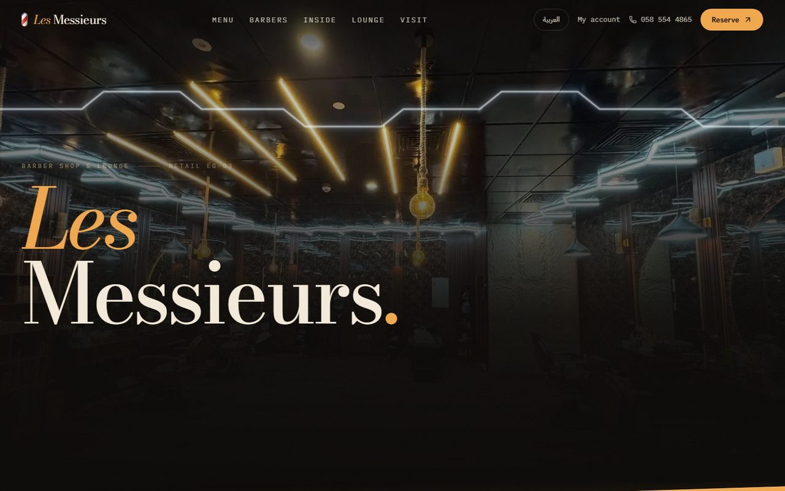

# Hi, I'm Laith 👋

Software engineer building web platforms, mobile apps and home-automation software. I run
**[Beavely](https://beavely.com)**, a small tech studio that designs, builds and hosts sites
and apps for real clients, end to end: code, servers, domains and monitoring.

## 🚀 Live projects

<table>
  <tr>
    <td width="50%" valign="top">
      
      <h3><a href="https://beavely.com">Beavely</a></h3>
      Our studio's site and brand kit. 
      <b>Stack:</b> Vite · React 
      🌐 <a href="https://beavely.com">beavely.com</a>
    </td>
    <td width="50%" valign="top">
      
      <h3><a href="https://www.wbn.ps">Watar Media Network</a></h3>
      Arabic-first news site for a Palestinian media network, with an editors' desk, programs and ads. 
      <b>Stack:</b> Next.js 16 · Postgres 18 · Drizzle · Cloudflare 
      🌐 <a href="https://www.wbn.ps">wbn.ps</a>
    </td>
  </tr>
  <tr>
    <td width="50%" valign="top">
      
      <h3><a href="https://www.salonlesmessieurs.com">Les Messieurs</a></h3>
      Barbershop &amp; lounge site with online booking, customer accounts and an owner dashboard. Arabic / English. 
      <b>Stack:</b> Next.js 16 · React 19 · Tailwind v4 · Framer Motion · SQLite 
      🌐 <a href="https://www.salonlesmessieurs.com">salonlesmessieurs.com</a>
    </td>
    <td width="50%" valign="top">
      
      <h3><a href="https://ladyofshepherds.com">Our Lady of the Shepherds</a></h3>
      Parish site in Beit Sahour, plus a private accounts app that records income and expenses and exports the monthly and annual Excel reports. 
      <b>Stack:</b> Python · Flask · SQLite · Docker 
      🌐 <a href="https://ladyofshepherds.com">ladyofshepherds.com</a>
    </td>
  </tr>
</table>

| Project | What it is | Stack | Link | Hosting |
| --- | --- | --- | --- | --- |
| **[PiggyBank](https://github.com/LaithAbusada/PiggyBank)** | Personal finance tracker. Bank SMS go through an iOS Shortcut into the app, get parsed by user-defined regex rules, and are stored as multi-currency transactions. | Next.js 16 · Prisma · Postgres · Clerk | [piggy-bank-taupe-xi.vercel.app](https://piggy-bank-taupe-xi.vercel.app) | Vercel + Supabase |
| **Mais Sewing payroll** | Arabic payroll app that replaced a sewing workshop's monthly Excel salary sheets. | Node · `node:sqlite` | Private (client login) | Beavely server |
| **Beavely HQ** | Internal dashboard: every project, its domains (uptime, SSL and renewal checks), access and studio money. | Node · `node:sqlite` | Private | Beavely server |

## 🏗️ How it's hosted

Client sites run on our own server rather than per-site SaaS hosting:

- **Server:** Netcup VPS (Debian)
- **Deploys:** [Coolify](https://coolify.io) builds each repo from its Dockerfile on every push to the deploy branch. Live in about a minute.
- **Routing &amp; SSL:** Traefik with automatic Let's Encrypt certificates
- **DNS:** Cloudflare
- **Monitoring:** self-hosted [GlitchTip](https://glitchtip.com) for errors and uptime, with alerts to Discord
- **Data:** SQLite or Postgres on persistent volumes, with daily backups

Side projects like PiggyBank deploy to **Vercel**.

## 🏠 Home automation & Android

- **Home automation panel app:** Kotlin app for wall-mounted smart-home touch panels, with an Odoo backend
- **[Touch Panel Updater](https://github.com/LaithAbusada/TouchPanelUpdater):** C# / WinForms tool that connects to touch panels over ADB, installs app updates and reboots them
- **[AppSwitcher](https://github.com/LaithAbusada/AppSwitcher):** Kotlin Android app with a floating overlay for switching between chosen apps, starts on boot

## 🧪 Earlier work

[Event Management App](https://github.com/LaithAbusada/Event-Management-Application) ([live](https://event-management-application-theta.vercel.app)) ·
[Recipe Sharing Platform](https://github.com/LaithAbusada/Recipe-Sharing-Platform) ·
[Weather Dashboard](https://github.com/LaithAbusada/WeatherPlatform) ·
[Ambient Video Player](https://github.com/LaithAbusada/Ambient) ·
[Shahid Carousel](https://github.com/LaithAbusada/Shahid-Carousel) ·
**ProGas** (fuel price prediction, React + Python ML) ·
**Magic Cube Driver** (Next.js web UI)

## 🛠️ Tech stack

**Web:** TypeScript · React · Next.js · Tailwind CSS · Node.js · Python / Flask · GraphQL 
**Mobile:** Kotlin · Flutter 
**Data:** PostgreSQL · SQLite · Prisma · Drizzle 
**Infra:** Docker · Coolify · Traefik · Cloudflare · Vercel · Linux

## 📫 Let's connect

